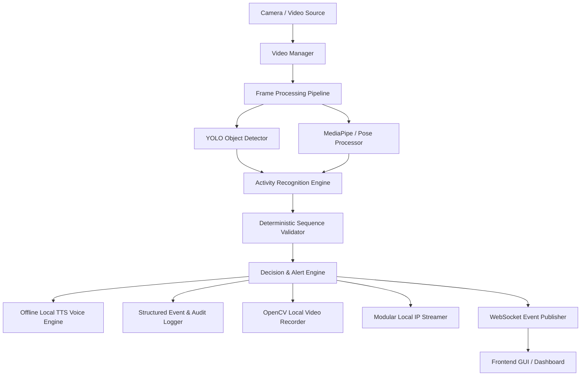

# AURAVISION System Architecture

## 1. High-Level Data Flow

## 2. Core Architectural Pillars

### Local-First & 100% Offline Guarantee
- All state transitions, video processing, activity inference, database persistence, and voice alerts operate completely on local edge hardware.
- No outbound internet connections, no cloud telemetry, no third-party APIs.

### Modular ML Adapter Pattern
- All AI/ML models are decoupled through abstract base classes (`BaseObjectDetector`, `BasePoseEstimator`, `BaseActivityRecognizer`).
- The system starts in Development / Mock mode if model weights are not loaded, providing deterministic scenario simulations without crashing.

### Deterministic State Machine Sequence Validator
- Operates on configurable protocols (step 1..N).
- Guards against low-confidence detections (`confidence < threshold` -> `VERIFY_REQUIRED`).
- Flags skipped steps (`STEP_SKIPPED`), out-of-sequence actions (`OUT_OF_SEQUENCE`), and unexpected actions (`UNKNOWN_ACTION`).
- Automatically produces next-step suggestions with human-readable guidance.
